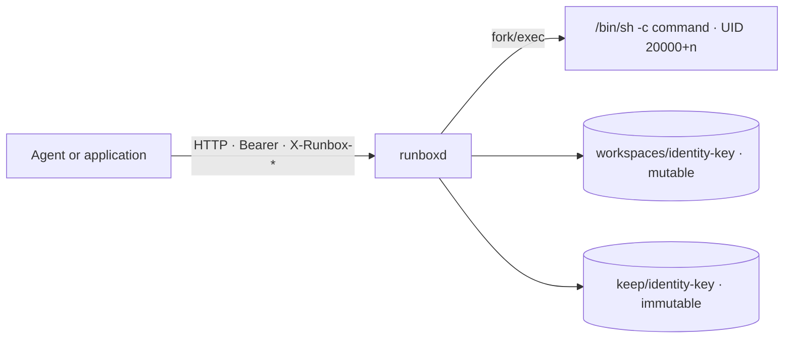

<p align="center">
  <a href="https://github.com/xy200303/runbox">
    
  </a>
</p>

<p align="center">
  <a href="#quick-start">Quick start</a> ·
  <a href="docs/api.md">API</a> ·
  <a href="docs/deployment.md">Deployment</a> ·
  <a href="docs/security.md">Security</a> ·
  <a href="docs/comparison.md">Comparison</a> ·
  <a href="examples/">Examples</a> ·
  <a href="README.zh-CN.md">简体中文</a>
</p>

<p align="center">
  <a href="https://github.com/xy200303/runbox/actions/workflows/ci.yml"></a>
  
  
  
  
  
  
</p>

<p align="center">
  <sub><strong>3.8k</strong> lines of Go · <strong>0</strong> Go dependencies · <strong>1</strong> binary · <strong>1</strong> container · <strong>1</strong> volume</sub>
</p>

---

**Runbox** is a lightweight sandbox for agent workloads. It gives each caller a persistent Linux workspace: upload inputs, run Python, Node or shell commands, and collect the results. Identities share one long-running container, but keep separate UIDs, private workspaces, quotas and an immutable archive.

It is small on purpose: one Go binary, one container, one volume, and a single HTTP API. The name is literal: **run in a box**.

## Why Runbox?

Container-per-sandbox platforms isolate every sandbox in its own container. MicroVM platforms go further with a VM per sandbox. Both are the right trade-off for mutually hostile tenants — and both are heavy on a single machine: one more container or VM per user, often another copy of Python/LibreOffice, and another thing to schedule.

Runbox takes the **dify-sandbox shape**: one long-lived container, many identities. Isolation comes from Linux credentials, file modes, path resolution and quotas — not from a new container per user. On top of that shape, Runbox adds a file isolation layer that a plain per-task UID sandbox does not have.

| | Container per sandbox | MicroVM per sandbox | **Runbox** |
|---|---|---|---|
| Isolation unit | one container per sandbox | one VM per sandbox | UID + private workspace in one container |
| New runtime per identity | yes | yes | **no** |
| Single-machine footprint | control plane + many containers | KVM + runtime + VM images | **one binary, one container, one volume** |
| Cold start per identity | container start or pool checkout | VM boot or snapshot restore | **none** |
| File isolation | volume or API per sandbox | strong | **built-in per identity** |
| Best fit | multi-node, stronger per-sandbox isolation | hostile tenants | **internal or semi-trusted, single machine** |

Choose Runbox when you want one container next to your application, semi-trusted commands, Python/Node/shell workloads, and per-identity file isolation without operating a sandbox platform. If tenants are mutually hostile, run Runbox under gVisor or a microVM instead of treating the shared kernel as a VM boundary.

## Features

| | What you get |
|---|---|
| **One container, many identities** | The HTTP runner and the execution environment share one long-lived container. Each identity runs under its own UID; calls for one identity are serialized, different identities run concurrently. |
| **Per-identity file isolation** | A private workspace, a workspace quota and an immutable archive outside the writable tree. Symlinks cannot be used to read or exfiltrate runner-owned files. |
| **Persistent workspaces** | Installed packages and intermediate files survive across calls. `HOME`, XDG directories and pip/npm prefixes all point inside the workspace and count toward the quota. |
| **Immutable deliverables** | Files produced under `out/` are returned as opaque file IDs. Archiving copies them into `keep/`, outside the writable tree, so later commands cannot alter a delivered file. |
| **Bounded everything** | Upload size, command length, input count, captured stdout (head + tail), output count and size, workspace quota, archive quota, timeout, concurrency and retention. |
| **Files are first-class** | Upload, execute with inputs, list, download by opaque ID or workspace path, archive, delete. Attachments stream as multipart; plain calls use JSON. |
| **Fail-closed hardening** | Read-only root filesystem, dropped capabilities, `no-new-privileges`, tini as PID 1. Startup refuses to run as root without the capabilities it needs. |
| **Observable by default** | `/ready` readiness, Prometheus metrics at `/metrics`, structured text or JSON request logs. |
| **Small enough to audit** | Stdlib-only Go implementation with a small operational footprint. |

## Quick start

### 1. Start the runner

```bash
git clone https://github.com/xy200303/runbox.git
cd runbox
cp .env.example .env
# set RUNBOX_API_KEY to a long random value: openssl rand -hex 32
docker compose up -d --build
curl -fsS http://localhost:8099/health
```

```json
{"status":"healthy","version":"dev","uptime_seconds":2}
```

The default image includes LibreOffice, Python and Node. For text/code workloads that do not need Office conversion, build the smaller image:

```bash
docker build --target minimal -t runbox:minimal .
```

### 2. Run a command

```bash
export RUNBOX_API_KEY="$(grep '^RUNBOX_API_KEY=' .env | cut -d= -f2)"

curl -fsS http://localhost:8099/v1/exec \
  -H "Authorization: Bearer $RUNBOX_API_KEY" \
  -H "X-Runbox-Namespace: team-a" \
  -H "X-Runbox-Principal: user-42" \
  -H "Content-Type: application/json" \
  -d '{"command":"echo hello from runbox"}'
```

```json
{"exit_code":0,"stdout":"hello from runbox\n","files":[],"duration_ms":3}
```

### 3. Produce and fetch a file

```bash
curl -fsS http://localhost:8099/v1/exec \
  -H "Authorization: Bearer $RUNBOX_API_KEY" \
  -H "X-Runbox-Namespace: team-a" \
  -H "X-Runbox-Principal: user-42" \
  -H "Content-Type: application/json" \
  -d '{"command":"mkdir -p out && echo hello > out/report.txt"}'
```

The response contains a `file_id` for `out/report.txt`. Download it with `GET /v1/files/{id}`, or archive an immutable copy with `POST /v1/files/{id}/keep`.

### 4. Or run from source

Windows, macOS and Linux are supported for development. UID isolation is Linux-only.

```bash
make run
# or
RUNBOX_ALLOW_ANONYMOUS=1 RUNBOX_ROOT=./.runbox go run ./cmd/runboxd
```

## Use from Go

```go
import (
    "context"
    "os"
    "time"

    "github.com/xy200303/runbox/sandbox"
)

client, err := sandbox.NewClient(sandbox.ClientOptions{
    BaseURL:  "http://localhost:8099",
    APIKey:   os.Getenv("RUNBOX_API_KEY"),
    Identity: sandbox.ScopedIdentity("team-a", "user-42"),
})
if err != nil {
    return err
}

result, err := client.Run(context.Background(), sandbox.ExecRequest{
    Command: `python3 -c "print(6 * 7)"`,
    Timeout: 30 * time.Second,
})
if err != nil {
    return err
}

// result.ExitCode is a normal result: the command ran and chose to exit.
fmt.Println(result.Stdout)
for _, file := range result.Files {
    out, err := os.Create(filepath.Base(file.Name))
    if err != nil {
        return err
    }
    if _, err := client.DownloadTo(context.Background(), file.FileID, out); err != nil {
        out.Close()
        return err
    }
    out.Close()
}
```

Attachments stream straight from an `io.Reader`:

```go
result, err := client.Run(ctx, sandbox.ExecRequest{
    Command: "python3 analyze.py files/input.csv",
    Files:   []sandbox.FileUpload{{Name: "input.csv", Reader: file}},
})
```

`Client` also implements `sandbox.Backend`: use `Exec(ctx, identity, …)` when the identity is passed per call, or `Run` with a client bound to one identity.

## Use from Python or curl

The repository ships a stdlib-only Python client and CLI:

```bash
RUNBOX_URL=http://localhost:8099 \
RUNBOX_API_KEY="$RUNBOX_API_KEY" \
RUNBOX_NAMESPACE=team-a RUNBOX_PRINCIPAL=user-42 \
python3 examples/python/runbox_client.py exec "echo hello"
```

A full curl walkthrough — upload, exec, list, download, archive — is in [`examples/curl.sh`](examples/curl.sh). More clients: [`examples/go`](examples/go) and [`examples/python`](examples/python).

## Identity model

Every request carries exactly one identity form:

| Mode | Headers | Use when |
|---|---|---|
| Single token | `X-Runbox-Identity: <token>` | Your application already mints an opaque subject ID. |
| Scoped | `X-Runbox-Namespace: <namespace>`<br>`X-Runbox-Principal: <principal>` | You need tenant + user, and want metadata for tenant-level operations later. |

Rules:

- Supplying both forms, or only half of the scoped form, returns `400`.
- Tokens are 1–256 visible ASCII characters with no spaces.
- Namespace and principal are 1–128 characters from `[A-Za-z0-9._-]`.
- Both forms normalize to one canonical SHA-256 key; storage paths use that key.
- Raw tokens are never written to disk. Scoped namespace/principal are stored as identity metadata in `state/identities/<key>.json`.
- File IDs are bound to an identity. Accessing another identity's file ID returns `403`.

Authentication is `Authorization: Bearer <RUNBOX_API_KEY>`. `/health` and `/ready` are unauthenticated; everything else requires the bearer token.

## API at a glance

| Method | Path | Purpose |
|---|---|---|
| GET | `/health` | Liveness, version, uptime (no auth) |
| GET | `/ready` | Readiness: storage directories exist and are writable (no auth) |
| GET | `/metrics` | Prometheus metrics (auth required) |
| GET | `/v1/capabilities` | Limits and detected tooling |
| POST | `/v1/exec` | Run a command (JSON or multipart) |
| POST | `/v1/files` | Upload one file |
| GET | `/v1/files/{id}` | Download a file by ID |
| POST | `/v1/files/{id}/keep` | Archive a file immutably |
| GET | `/v1/path?path=out/x` | Download by workspace path |
| GET | `/v1/list?path=out` | List a workspace directory |
| DELETE | `/v1/workspace[?purge=true]` | Remove the workspace (and optionally the archive) |

Full request and response reference: [docs/api.md](docs/api.md).

## How it works



```text
RUNBOX_ROOT/
├── workspaces/<identity-key>/       0750, owned by the identity's UID
│   ├── files/                       uploaded inputs
│   ├── out/                         files returned from the last command
│   ├── .local/  .npm-global/        persistent pip / npm installs
│   ├── .cache/  .config/  .tmp/     persistent XDG state and temp files
│   └── ...
├── keep/<identity-key>/             immutable deliverables, runner-owned
└── state/
    ├── uids/<identity-key>          stable UID assignment
    └── identities/<key>.json        identity metadata (never the token)
```

- The command runs in its own process group as the identity's UID. A timeout kills the group, not the container.
- Output is captured with a bounded head + tail buffer, so a command printing gigabytes cannot exhaust RAM.
- Files created under `out/` during the call are returned as file IDs that point into the workspace. `POST /v1/files/{id}/keep` copies one into `keep/`, outside the writable workspace, so later commands cannot change it. `?purge=true` removes the archive with the workspace.
- A janitor removes workspaces idle longer than the retention window; `keep/` is untouched.
- The API key is compared in constant time; identity values are validated, not sanitized — sanitizing would merge distinct identities onto one workspace.

More detail: [docs/architecture.md](docs/architecture.md).

## Security

- Path resolution rejects `..`, absolute paths, Windows drive letters and symlink escapes. Serving a symlink planted in the workspace would otherwise read files as root.
- Commands never inherit the runner's environment, including the API key.
- The compose file runs read-only with `cap_drop: ALL`, adds only `CHOWN`, `FOWNER`, `SETUID`, `SETGID`, `DAC_OVERRIDE` and `KILL`, sets `no-new-privileges`, and caps memory, CPU and pids.
- Images run tini as PID 1 so killed command trees are reaped.
- Startup fails closed when running as root without the required capabilities. `RUNBOX_ALLOW_MISSING_CAPS=1` is a development-only override.

> Runbox is not a strong multi-tenant boundary on its own. It relies on the container's namespaces/cgroups plus per-UID file permissions. For hostile tenants, run it under gVisor or a microVM. See [docs/security.md](docs/security.md).

## Operations

- `/ready` verifies that the data directories exist and the state directory is writable.
- `/metrics` exposes bounded Prometheus counters: requests, execs, timeouts, busy, upload/download bytes, archives, workspace deletes, active commands and uptime.
- Graceful shutdown cancels in-flight commands after the configured budget and kills their process groups.
- Logs are structured text or JSON (`RUNBOX_LOG_FORMAT`).

See [docs/production.md](docs/production.md) for the production checklist: SLOs, capacity, quotas, key handling, gVisor, multi-replica and runbooks.

<details>
<summary><strong>All configuration</strong></summary>

Durations accept `30s`, `15m`, `7d` or bare seconds; sizes accept `20MiB`, `20MB`, `1GiB` or bytes.

| Variable | Default | Meaning |
|---|---|---|
| `RUNBOX_API_KEY` | — (required) | Shared API key. Startup fails without it unless anonymous mode is on. |
| `RUNBOX_ALLOW_ANONYMOUS` | `false` | Disable authentication. Local development only. |
| `RUNBOX_ALLOW_MISSING_CAPS` | `false` | Allow root startup without the Linux capabilities Runbox needs. Development only; production fails closed. |
| `RUNBOX_ADDR` | `:8099` | Listen address. |
| `RUNBOX_ROOT` | `.runbox` | Data root. The image sets `/workspace`. |
| `RUNBOX_MAX_CONCURRENCY` | `2` | Concurrent commands per runner. Excess calls get `409 busy`. |
| `RUNBOX_MAX_REQUEST_BYTES` | `200MiB` | HTTP body limit. |
| `RUNBOX_MAX_UPLOAD_BYTES` | `20MiB` | Per-file limit. |
| `RUNBOX_MAX_COMMAND_BYTES` | `64KiB` | Maximum command length. |
| `RUNBOX_MAX_INPUTS` | `64` | Maximum inputs (file IDs plus multipart files) per execution. |
| `RUNBOX_MAX_STDOUT_BYTES` | `200KiB` | Captured stdout+stderr limit; keeps the head and the tail. |
| `RUNBOX_MAX_OUTPUT_FILES` | `20` | Files returned from one execution. |
| `RUNBOX_MAX_OUTPUT_BYTES` | `200MiB` | Total output size returned from one execution. |
| `RUNBOX_QUOTA_BYTES` | `1GiB` | Per-workspace quota; execution is refused above it. `0` = unlimited. |
| `RUNBOX_KEEP_BYTES` | `1GiB` | Per-identity archive quota. `0` = unlimited. |
| `RUNBOX_RETENTION` | `7d` | Idle workspace retention. |
| `RUNBOX_SWEEP_INTERVAL` | `1h` | Janitor interval. |
| `RUNBOX_UID_MIN` / `RUNBOX_UID_MAX` | `20000` / `20100` | UID pool used for Linux isolation. |
| `RUNBOX_DEFAULT_TIMEOUT` | `60s` | Timeout when the request omits one. |
| `RUNBOX_MAX_TIMEOUT` | `300s` | Upper bound; longer requests are clamped. |
| `RUNBOX_SHUTDOWN_TIMEOUT` | `30s` | Graceful shutdown budget. |
| `RUNBOX_TLS_CERT` / `RUNBOX_TLS_KEY` | — | Terminate TLS in-process. A reverse proxy is usually better. |
| `RUNBOX_LOG_FORMAT` | `text` | `text` or `json`. |

</details>

## Image contents

| Capability | Full | Minimal |
|---|---|---|
| Python 3, Node, npm, git, curl, unzip/zip | yes | yes |
| `pdftotext` | yes | yes |
| LibreOffice (Writer/Calc/Impress) | yes | no |
| CJK fonts | yes | no |
| Python document/data libraries | yes | no |
| Node `xlsx`, `csv-parse`, `dayjs` | yes | no |

Build arguments for restricted networks: `GOPROXY`, `APT_MIRROR`, `PIP_INDEX`, `NPM_REGISTRY`. See [docs/deployment.md](docs/deployment.md).

## Comparison

| | Runbox | Container-per-sandbox (OpenSandbox / CubeSandbox) | MicroVM (E2B / microsandbox) |
|---|---|---|---|
| Isolation unit | UID + private workspace in one container | one container (or pool slot) per sandbox | one VM per sandbox |
| New container/VM per user | no | yes | yes |
| Single-machine footprint | one binary, one container, one volume | control plane + many containers | KVM + runtime + VM images |
| Startup per identity | no container/VM boot | container start or pool checkout | VM boot or snapshot restore |
| File isolation | built-in: workspace, quota, immutable archive, symlink-safe | volume or API per sandbox | strong |
| Best fit | internal/semi-trusted, single machine | multi-node, stronger per-sandbox isolation | hostile tenants |

OpenSandbox and CubeSandbox are control-plane projects and support different deployment modes; the column describes the common container-per-sandbox model, not a claim about every mode. See [docs/comparison.md](docs/comparison.md) for gVisor, Dify and the full trade-off list.

The closest prior art is **dify-sandbox**: one container with a per-task UID. Runbox keeps that shape and adds the per-identity file isolation described above.

## FAQ

<details>
<summary><strong>Does every user get a container?</strong></summary>

No. Every identity shares one long-lived container and gets a UID plus a private workspace inside it. That is what makes single-machine deployment practical.

</details>

<details>
<summary><strong>Can I run untrusted code?</strong></summary>

Not as a hard multi-tenant boundary. Runbox uses the container's namespaces and cgroups plus per-UID file permissions, so the kernel is shared. For hostile tenants, run it under gVisor or a microVM.

</details>

<details>
<summary><strong>How is it different from Dify's sandbox?</strong></summary>

Dify's sandbox is part of the Dify stack and scopes files per task. Runbox is standalone, exposes a stable HTTP contract, and adds per-identity workspaces, quotas, an immutable archive and symlink-safe paths.

</details>

<details>
<summary><strong>Does it work on Windows or macOS?</strong></summary>

For development, yes. Production isolation is Linux-only, because per-identity UID isolation depends on Linux credentials and file ownership.

</details>

## Roadmap

- [ ] Egress policy hooks for commands that must not reach the internet
- [ ] HTTP range requests for large downloads
- [ ] Shared storage or per-identity routing for multi-replica deployments
- [ ] Optional hard disk quotas per identity
- [ ] A maintained seccomp profile and a gVisor deployment recipe
- [ ] Tenant admin API: namespace-level usage, quota and purge
- [ ] Published container images and tagged Go module releases

## Contributing

Issues and pull requests are welcome. Before opening a PR, run:

```bash
make check   # gofmt, go vet, go test -race
```

See [CONTRIBUTING.md](CONTRIBUTING.md) for the development workflow and [SECURITY.md](SECURITY.md) for reporting security issues.

## License

MIT. See [LICENSE](LICENSE).

<p align="center">
  <sub><strong>Run in a box.</strong> If Runbox is useful to you, a star helps others find it.</sub>
</p>
