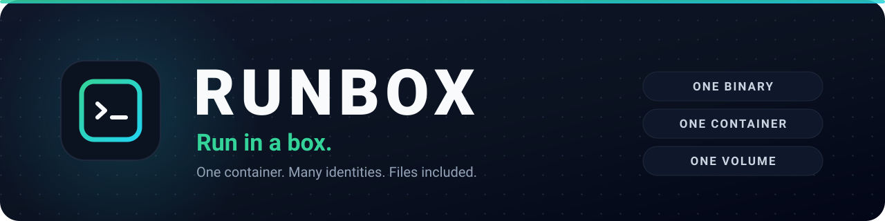
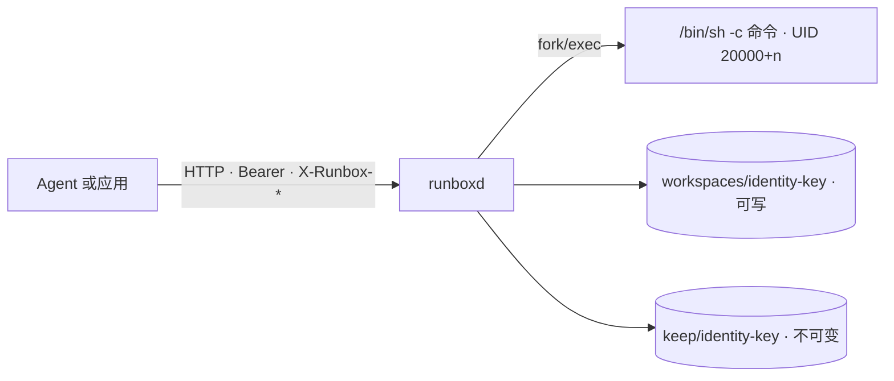

<p align="center">
  <a href="https://github.com/xy200303/runbox">
    
  </a>
</p>

<p align="center">
  <a href="#快速开始">快速开始</a> ·
  <a href="docs/api.md">API</a> ·
  <a href="docs/deployment.md">部署</a> ·
  <a href="docs/security.md">安全</a> ·
  <a href="docs/comparison.md">对比</a> ·
  <a href="examples/">示例</a> ·
  <a href="README.md">English</a>
</p>

<p align="center">
  <a href="https://github.com/xy200303/runbox/actions/workflows/ci.yml"></a>
  
  
  
  
  
  
</p>

<p align="center">
  <sub><strong>3.8k</strong> 行 Go · <strong>1</strong> 个二进制 · <strong>1</strong> 个容器 · <strong>1</strong> 个卷</sub>
</p>

---

**Runbox** 是给 Agent 负载使用的轻量沙箱。它为每个调用方提供可持久化的 Linux 工作区：上传输入、执行 Python / Node / Shell、取回结果。多个身份共享一个长期运行的容器，同时各自拥有独立 UID、私有工作区、配额和不可变归档。

部署保持简单：一个 Go 二进制、一个容器、一个卷，对外只有一套 HTTP 接口。名字就是字面意思：**run in a box**。

## 为什么是 Runbox？

container-per-sandbox 类方案为每个沙箱准备独立容器；microVM 类方案更进一步，每个沙箱一台虚拟机。面对互相敌对的租户，这是正确的取舍；但在单机上，两者都很重：每个用户或任务多一个容器或虚拟机，往往还多一份 Python/LibreOffice，也多一份要调度和维护的东西。

Runbox 采用 **dify-sandbox 的形态**：一个长期运行的容器，承载多个身份。隔离来自 Linux 凭据、文件权限、路径解析和配额，而不是“每个用户一个容器”。在这个形态之上，Runbox 补上了普通 per-task UID 沙箱没有的**文件隔离层**。

| | 每个沙箱一个容器 | 每个沙箱一台 microVM | **Runbox** |
|---|---|---|---|
| 隔离单位 | 每个沙箱一个容器 | 每个沙箱一台虚拟机 | 单容器内 UID + 私有工作区 |
| 每个身份新建运行时 | 是 | 是 | **否** |
| 单机部署占用 | 控制面 + 多个容器 | KVM + 运行时 + VM 镜像 | **一个二进制、一个容器、一个卷** |
| 每个身份的冷启动 | 容器启动或池中取出 | VM 启动或快照恢复 | **无** |
| 文件隔离 | 依赖卷或 API | 强 | **内置，按身份隔离** |
| 适合 | 多机、更强的单沙箱隔离 | 敌对租户 | **内部或半可信、单机** |

需要把沙箱放在应用旁边、命令是半可信的、工作负载是 Python / Node / Shell、又需要按身份隔离文件时，选 Runbox。如果租户互相敌对，请把 Runbox 放到 gVisor 或 microVM 下，不要把共享内核当成 VM 边界。

## 特性

| | 说明 |
|---|---|
| **单容器、多身份** | HTTP runner 与执行环境共处一个长期运行的容器。每个身份用自己的 UID；同一身份的调用串行，不同身份可并发。 |
| **按身份隔离文件** | 私有工作区、工作区配额、可写目录之外的不可变归档。符号链接无法用来读取或带出 runner 拥有的文件。 |
| **工作区可持久化** | 安装过的包和中间文件跨调用保留。`HOME`、XDG 目录、pip/npm 前缀都在工作区内，并计入配额。 |
| **交付文件不可篡改** | 执行期间写入 `out/` 的文件以不透明 file ID 返回。归档会复制进可写目录之外的 `keep/`，后续命令改不了已交付文件。 |
| **所有资源都有边界** | 上传大小、命令长度、输入数量、stdout（保留首尾）、产物数量与大小、工作区配额、归档配额、超时、并发和保留期。 |
| **文件是一等公民** | 上传、带输入执行、列目录、按不透明 ID 或工作区路径下载、归档、删除。带附件走流式 multipart，普通调用走 JSON。 |
| **大文件** | 上传边读边落盘，不把整个请求体读进内存；下载支持 `Range` 和 `HEAD`。 |
| **默认 fail-closed** | 只读根文件系统、丢弃能力、`no-new-privileges`、tini 作为 PID 1。以 root 启动却缺少所需能力时拒绝启动。 |
| **自带可观测性** | `/ready` 就绪检查、`/metrics` Prometheus 指标、文本或 JSON 结构化日志。 |
| **小到可以通读** | HTTP 层使用 Gin，SDK 保持仅标准库，运维面很小。 |

## 快速开始

### 1. 启动

```bash
git clone https://github.com/xy200303/runbox.git
cd runbox
cp .env.example .env
# 写入足够长的 RUNBOX_API_KEY：openssl rand -hex 32
docker compose up -d --build
curl -fsS http://localhost:8099/health
```

```json
{"status":"healthy","version":"dev","uptime_seconds":2}
```

默认镜像包含 LibreOffice、Python 和 Node。只做文本/代码任务、不需要 Office 转换时，构建精简镜像：

```bash
docker build --target minimal -t runbox:minimal .
```

### 2. 执行命令

```bash
export RUNBOX_API_KEY="$(grep '^RUNBOX_API_KEY=' .env | cut -d= -f2)"

curl -fsS http://localhost:8099/v1/exec \
  -H "Authorization: Bearer $RUNBOX_API_KEY" \
  -H "X-Runbox-Namespace: team-a" \
  -H "X-Runbox-Principal: user-42" \
  -H "Content-Type: application/json" \
  -d '{"command":"echo hello from runbox"}'
```

```json
{"exit_code":0,"stdout":"hello from runbox\n","files":[],"duration_ms":3}
```

### 3. 产出并取回文件

```bash
curl -fsS http://localhost:8099/v1/exec \
  -H "Authorization: Bearer $RUNBOX_API_KEY" \
  -H "X-Runbox-Namespace: team-a" \
  -H "X-Runbox-Principal: user-42" \
  -H "Content-Type: application/json" \
  -d '{"command":"mkdir -p out && echo hello > out/report.txt"}'
```

响应里会返回 `out/report.txt` 的 `file_id`。用 `GET /v1/files/{id}` 下载，或用 `POST /v1/files/{id}/keep` 归档一份不可变副本。

### 4. 或从源码运行

Windows、macOS 和 Linux 都可以用于开发；UID 隔离只在 Linux 上生效。

```bash
make run
# 或者
RUNBOX_ALLOW_ANONYMOUS=1 RUNBOX_ROOT=./.runbox go run ./cmd/runboxd
```

## 在 Go 中使用

```go
import (
    "context"
    "os"
    "time"

    "github.com/xy200303/runbox/sandbox"
)

client, err := sandbox.NewClient(sandbox.ClientOptions{
    BaseURL:  "http://localhost:8099",
    APIKey:   os.Getenv("RUNBOX_API_KEY"),
    Identity: sandbox.ScopedIdentity("team-a", "user-42"),
})
if err != nil {
    return err
}

result, err := client.Run(context.Background(), sandbox.ExecRequest{
    Command: `python3 -c "print(6 * 7)"`,
    Timeout: 30 * time.Second,
})
if err != nil {
    return err
}

// ExitCode 非零是正常结果：命令执行了，并选择了非零退出。
fmt.Println(result.Stdout)
for _, file := range result.Files {
    out, err := os.Create(filepath.Base(file.Name))
    if err != nil {
        return err
    }
    if _, err := client.DownloadTo(context.Background(), file.FileID, out); err != nil {
        out.Close()
        return err
    }
    out.Close()
}
```

附件直接从 `io.Reader` 流式上传：

```go
result, err := client.Run(ctx, sandbox.ExecRequest{
    Command: "python3 analyze.py files/input.csv",
    Files:   []sandbox.FileUpload{{Name: "input.csv", Reader: file}},
})
```

`Client` 同时实现 `sandbox.Backend`：每次调用单独传身份时用 `Exec(ctx, identity, …)`；绑定单一身份时用 `Run`。

## 在 Python 或 curl 中使用

仓库自带仅依赖标准库的 Python 客户端和 CLI：

```bash
RUNBOX_URL=http://localhost:8099 \
RUNBOX_API_KEY="$RUNBOX_API_KEY" \
RUNBOX_NAMESPACE=team-a RUNBOX_PRINCIPAL=user-42 \
python3 examples/python/runbox_client.py exec "echo hello"
```

完整的 curl 走查（上传、执行、列目录、下载、归档）见 [`examples/curl.sh`](examples/curl.sh)。更多客户端：[`examples/go`](examples/go)、[`examples/python`](examples/python)。

## 身份模型

每个请求必须且只能携带一种身份形式：

| 模式 | 请求头 | 适用场景 |
|---|---|---|
| 单一 token | `X-Runbox-Identity: <token>` | 应用本身已经能生成不透明的主体 ID。 |
| 租户 + 用户 | `X-Runbox-Namespace: <namespace>`<br>`X-Runbox-Principal: <principal>` | 需要区分租户和用户，并希望保留元数据供后续租户级操作使用。 |

规则：

- 同时传两种形式，或只传 scoped 形式的一半，返回 `400`。
- token 为 1–256 个可见 ASCII 字符，不能包含空格。
- namespace 和 principal 各为 1–128 个字符，字符集 `[A-Za-z0-9._-]`。
- 两种形式都会规范化为一个 canonical SHA-256 key，存储路径使用该 key。
- 原始 token 不落盘；scoped 的 namespace/principal 和 UID 分配保存在 `state/runbox.db` 的 `identities` 表中。
- file ID 绑定所属身份；访问其他身份的 file ID 返回 `403`。

鉴权使用 `Authorization: Bearer <RUNBOX_API_KEY>`。`/health` 和 `/ready` 不鉴权，其余接口都需要 Bearer token。

## 接口一览

| 方法 | 路径 | 作用 |
|---|---|---|
| GET | `/health` | 存活、版本、运行时长（不鉴权） |
| GET | `/ready` | 就绪：数据目录存在且可写（不鉴权） |
| GET | `/metrics` | Prometheus 指标（需鉴权） |
| GET | `/v1/capabilities` | 限额与检测到的工具 |
| POST | `/v1/exec` | 执行命令（JSON 或 multipart） |
| POST | `/v1/files` | 上传单个文件 |
| POST | `/v1/files/batch` | 一次上传多个文件 |
| GET | `/v1/files/{id}` | 按 ID 下载 |
| POST | `/v1/files/{id}/keep` | 归档为长期文件 |
| GET | `/v1/path?path=out/x` | 按工作区路径下载 |
| GET | `/v1/list?path=out` | 列工作区目录 |
| GET | `/v1/archive?path=out&path=tmp` | 按 tar 归档批量下载文件或目录 |
| DELETE | `/v1/workspace[?purge=true]` | 删除工作区（可选连归档一起删） |

完整请求/响应说明见 [docs/api.md](docs/api.md)。

## 工作机制



```text
RUNBOX_ROOT/
├── workspaces/<identity-key>/       0750，属主为该身份的 UID
│   ├── files/                       上传的输入
│   ├── out/                         上一次执行返回的产物
│   ├── .local/  .npm-global/        持久的 pip / npm 安装
│   ├── .cache/  .config/  .tmp/     持久的 XDG 状态与临时文件
│   └── ...
├── keep/<identity-key>/             不可变交付，属主为 runner
└── state/
    ├── runbox.db                    身份、UID 和元数据（SQLite）
    ├── runbox.db-wal                runner 运行期间的 WAL 日志
    └── runbox.db-shm                runner 运行期间的共享内存索引
```

- 命令在独立进程组、以该身份的 UID 执行；超时只杀进程组，不动容器。
- stdout 使用首尾有界缓冲，命令打印几个 GB 也不会撑爆内存。
- 执行期间写入 `out/` 的文件以 file ID 返回，ID 指向工作区。调用 `POST /v1/files/{id}/keep` 会把文件复制进可写工作区之外的 `keep/`，后续命令改不了；`?purge=true` 会连归档一起删除。
- 后台清理任务删除超过保留期未活动的工作区；`keep/` 不受影响。
- API Key 常量时间比较；身份只校验、不“净化”——净化会把不同身份映射到同一个工作区。

更多细节：[docs/architecture.md](docs/architecture.md)。

## 安全

- 路径解析拒绝 `..`、绝对路径、Windows 盘符和符号链接逃逸。否则 Agent 在工作区里放一个指向 `/etc/shadow` 的链接，root 身份的 runner 就会替它读取。
- 命令不继承 runner 的环境变量，包括 API Key。
- compose 配置使用只读根文件系统、`cap_drop: ALL`，仅补 `CHOWN`、`FOWNER`、`SETUID`、`SETGID`、`DAC_OVERRIDE` 和 `KILL`，启用 `no-new-privileges`，并限制内存、CPU 和 pids。
- 镜像以 tini 作为 PID 1，回收被终止的命令树。
- 以 root 启动却缺少所需能力时，进程直接拒绝启动。`RUNBOX_ALLOW_MISSING_CAPS=1` 仅限开发。

> Runbox 本身不是强多租户边界。它依赖容器 namespace/cgroup 与按 UID 的文件权限。面对互相敌对的租户，请用 gVisor 或 microVM 运行。详见 [docs/security.md](docs/security.md)。

## 运维

- `/ready` 检查数据目录存在、state 目录可写。
- `/metrics` 暴露有界的 Prometheus 计数器：请求、执行、超时、繁忙、上传/下载字节数、归档、工作区删除、活跃命令和运行时长。
- 优雅退出会在预算内取消在途命令，并杀掉对应进程组。
- 日志支持文本或 JSON（`RUNBOX_LOG_FORMAT`）。

商业部署清单见 [docs/production.md](docs/production.md)：SLO、容量、配额、密钥、gVisor、多副本和故障处理。

<details>
<summary><strong>完整配置</strong></summary>

时长支持 `30s`、`15m`、`7d` 或纯秒数；大小支持 `20MiB`、`20MB`、`1GiB` 或字节数。

| 变量 | 默认值 | 含义 |
|---|---|---|
| `RUNBOX_API_KEY` | —（必填） | 共享 API Key；未开启匿名模式时缺失则拒绝启动。 |
| `RUNBOX_ALLOW_ANONYMOUS` | `false` | 关闭鉴权，仅限本机开发。 |
| `RUNBOX_ALLOW_MISSING_CAPS` | `false` | 允许 root 在缺少 Linux 能力时启动。仅限开发；生产默认 fail closed。 |
| `RUNBOX_ADDR` | `:8099` | 监听地址。 |
| `RUNBOX_ROOT` | `.runbox` | 数据根目录；镜像里设为 `/workspace`。 |
| `RUNBOX_MAX_CONCURRENCY` | `2` | 单 runner 并发命令数；超出返回 `409 busy`。 |
| `RUNBOX_MAX_REQUEST_BYTES` | `200MiB` | HTTP 请求体上限。 |
| `RUNBOX_MAX_UPLOAD_BYTES` | `20MiB` | 单文件上限。 |
| `RUNBOX_MAX_COMMAND_BYTES` | `64KiB` | 单条命令长度上限。 |
| `RUNBOX_MAX_INPUTS` | `64` | 单次执行的输入上限（file ID + multipart 文件）。 |
| `RUNBOX_MAX_STDOUT_BYTES` | `200KiB` | 捕获的 stdout+stderr 上限，保留首尾。 |
| `RUNBOX_MAX_OUTPUT_FILES` | `20` | 单次执行返回的产物数量。 |
| `RUNBOX_MAX_OUTPUT_BYTES` | `200MiB` | 单次执行返回的产物总大小。 |
| `RUNBOX_MAX_BATCH_FILES` | `1000` | 单次批量上传或 tar 归档的文件数上限。 |
| `RUNBOX_MAX_BATCH_BYTES` | `1GiB` | 单次 tar 归档下载的总大小上限。 |
| `RUNBOX_QUOTA_BYTES` | `1GiB` | 单工作区配额；超出后拒绝执行。`0` 表示不限。 |
| `RUNBOX_KEEP_BYTES` | `1GiB` | 单身份归档配额。`0` 表示不限。 |
| `RUNBOX_RETENTION` | `7d` | 工作区闲置保留期。 |
| `RUNBOX_SWEEP_INTERVAL` | `1h` | 清理任务间隔。 |
| `RUNBOX_UID_MIN` / `RUNBOX_UID_MAX` | `20000` / `20100` | Linux 隔离使用的 UID 池。 |
| `RUNBOX_DEFAULT_TIMEOUT` | `60s` | 请求未指定时的超时。 |
| `RUNBOX_MAX_TIMEOUT` | `300s` | 超时上限，超出会被截断。 |
| `RUNBOX_SHUTDOWN_TIMEOUT` | `30s` | 优雅退出预算。 |
| `RUNBOX_TLS_CERT` / `RUNBOX_TLS_KEY` | — | 进程内终止 TLS；通常更推荐反向代理。 |
| `RUNBOX_LOG_FORMAT` | `text` | `text` 或 `json`。 |

</details>

## 镜像内容

| 能力 | 完整镜像 | 精简镜像 |
|---|---|---|
| Python 3、Node、npm、git、curl、unzip/zip | 有 | 有 |
| `pdftotext` | 有 | 有 |
| LibreOffice（Writer/Calc/Impress） | 有 | 无 |
| 中文字体 | 有 | 无 |
| Python 文档/数据类库 | 有 | 无 |
| Node `xlsx`、`csv-parse`、`dayjs` | 有 | 无 |

受限网络可用构建参数：`GOPROXY`、`APT_MIRROR`、`PIP_INDEX`、`NPM_REGISTRY`，见 [docs/deployment.md](docs/deployment.md)。

## 方案对比

| | Runbox | container-per-sandbox（OpenSandbox / CubeSandbox） | microVM（E2B / microsandbox） |
|---|---|---|---|
| 隔离单位 | 单容器内 UID + 私有工作区 | 每个沙箱一个容器（或池中一个槽位） | 每个沙箱一台虚拟机 |
| 每个用户新建容器/VM | 否 | 是 | 是 |
| 单机部署占用 | 一个二进制、一个容器、一个卷 | 控制面 + 多个容器 | KVM + 运行时 + VM 镜像 |
| 每个身份的启动成本 | 无容器/VM 启动 | 容器启动或池中取出 | VM 启动或快照恢复 |
| 文件隔离 | 内置：工作区、配额、不可变归档、符号链接防护 | 依赖卷或 API | 强 |
| 适合 | 内部/半可信、单机 | 多机、更强的单沙箱隔离 | 敌对租户 |

OpenSandbox、CubeSandbox 是带控制面的项目，支持不同部署形态；这一列描述的是常见的 container-per-sandbox 模式，不代表其所有模式。gVisor、Dify 的完整对比见 [docs/comparison.md](docs/comparison.md)。

最接近的先例是 **dify-sandbox**：一个容器 + 每任务 UID。Runbox 沿用这个形态，并补上前面说的按身份文件隔离。

## 常见问题

<details>
<summary><strong>每个用户都会新建容器吗？</strong></summary>

不会。所有身份共享一个长期运行的容器，每个身份在里面拥有一个 UID 和私有工作区。这正是它能单机部署的原因。

</details>

<details>
<summary><strong>可以执行不受信任的代码吗？</strong></summary>

不能把它当作强多租户边界。Runbox 使用容器的 namespace/cgroup 与按 UID 的文件权限，内核是共享的。面对敌对租户，请放到 gVisor 或 microVM 下运行。

</details>

<details>
<summary><strong>和 Dify 的 sandbox 有什么区别？</strong></summary>

Dify 的 sandbox 是 Dify 技术栈的一部分，按任务隔离文件。Runbox 是独立服务，提供稳定的 HTTP 契约，并增加了按身份的工作区、配额、不可变归档和符号链接安全解析。

</details>

<details>
<summary><strong>支持 Windows 或 macOS 吗？</strong></summary>

开发可以。生产隔离只支持 Linux，因为按身份 UID 隔离依赖 Linux 凭据和文件属主。

</details>

## 路线图

- [ ] 出网策略钩子，用于禁止命令访问互联网
- [ ] 多副本部署所需的共享存储或按身份路由
- [ ] 可选的按身份硬磁盘配额
- [ ] 维护中的 seccomp profile 与 gVisor 部署配方
- [ ] 租户管理 API：namespace 级用量、配额与清理
- [ ] 发布容器镜像与带 tag 的 Go module

## 贡献

欢迎提交 Issue 和 Pull Request。提交 PR 前请运行：

```bash
make check   # gofmt、go vet、go test -race
```

开发流程见 [CONTRIBUTING.md](CONTRIBUTING.md)，安全问题报告见 [SECURITY.md](SECURITY.md)。

## 许可证

MIT，见 [LICENSE](LICENSE)。

<p align="center">
  <sub><strong>Run in a box.</strong> 如果 Runbox 对你有用，点一个 star 能让更多人找到它。</sub>
</p>
